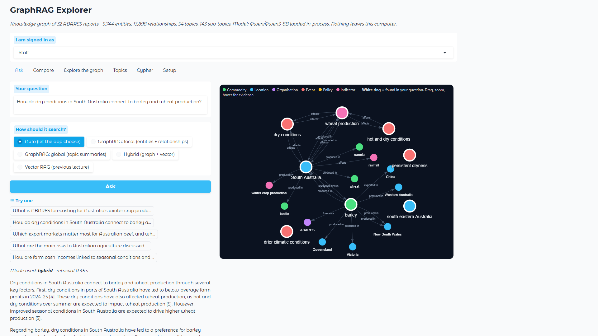

# Graph databases and GraphRAG: connect the dots your vector search misses

Code, data pipeline and desktop app for the **GeoAI Lab** lecture (Series 2, lecture 2).

* **Video:** _link added on publication_ on the [GeoAI Lab YouTube channel](https://www.youtube.com/channel/UC_HGuLPYUpp3s9LMVaDIX0A)
* **Previous lecture (vector RAG, same documents):** [geoai-rag-vector-database](https://github.com/IbrahimUWA/geoai-rag-vector-database)
* **Step-by-step guide:** [`STEP_BY_STEP.md`](STEP_BY_STEP.md) · **Results:** [`RESULTS.md`](RESULTS.md)
* **Short version of the results:** vector RAG stayed best on facts; GraphRAG global search drew with it on big-picture
  questions (winning the cross-cutting ones), but only after adding sub-topics and map-reduce - the first, flat version lost.

A knowledge graph built by a local open-weight LLM from **32 Australian government agriculture reports**
(ABARES, 1,338 pages, CC BY 4.0), stored in an embedded graph database (**Kuzu**, queried with **Cypher**), and an
app that answers questions with **GraphRAG** (local, global and hybrid search) next to classic vector RAG.
No API keys; no document or question leaves your computer.



## Install and run (Windows or Linux)

You need **Python 3.10-3.13** and about **8 GB of free disk** (most of it is the language model).
A GPU is optional: everything runs on CPU, just slower.

**Windows 10/11**
```bat
git clone https://github.com/IbrahimUWA/geoai-graph-rag
cd geoai-graph-rag
install.bat
```
**Linux**
```bash
git clone https://github.com/IbrahimUWA/geoai-graph-rag
cd geoai-graph-rag
bash install.sh
```
The installer:
1. creates a private Python environment in `.venv`,
2. installs PyTorch (the CUDA build if it finds an NVIDIA GPU, otherwise the CPU build) and the packages in `requirements.txt`,
3. downloads the ready-built knowledge graph (about 27 MB) so you do not have to run the LLM extraction,
4. installs [Ollama](https://ollama.com) if you agree and pulls **Qwen3-8B** (or Qwen3-4B on machines with less than 16 GB RAM),
5. adds a **GraphRAG Explorer** shortcut to your desktop (Windows) or applications menu (Linux).

Then start it with the shortcut, `run_app.bat` (Windows) or `./run_app.sh` (Linux). Your browser opens at
http://127.0.0.1:7861.

## Using the app

| Tab | What it does |
|---|---|
| **Ask** | Ask a question. Choose how it searches: *Auto*, *GraphRAG local*, *GraphRAG global*, *Hybrid* or *Vector RAG*. The answer cites its sources; on the right you see the exact part of the graph it used (drag, zoom, hover an edge to read the evidence). |
| **Compare** | The same question answered by vector RAG and by GraphRAG, side by side. |
| **Explore the graph** | Pick any entity (wheat, China, drought, ...) and walk its neighbourhood one or two hops out, filtered by type. |
| **Topics** | The communities (clusters of connected entities) and their summaries, which power global search. |
| **Cypher** | Query the graph database directly with read-only Cypher, with worked examples. |
| **Setup** | Model and database status, and how to switch models. |

The **"I am signed in as"** box demonstrates access control: a *Public visitor* never sees entities, relationships or
passages that come only from internal or restricted reports.

## How it works

```
PDFs ──> chunks ──> LLM extracts entities + relationships ──> entity resolution ──> Kuzu graph database
                                                                                     │
                     topics + sub-topics (Louvain, 2 levels) + LLM summaries ◄───────┤
                                                                                     ▼
question ──> link entities ──> walk relationships ──> facts + passages ──> LLM answer with citations   (local)
question ──> relevant sub-topic summaries ──> map: rated points ──> reduce ──> LLM answer              (global)
```

| Step | Script | What it does |
|---|---|---|
| 1 | `scripts/01_corpus.py` | Downloads the 32 reports listed in `data/pdfs/manifest.csv` and cuts them into 350-token chunks |
| 2 | `scripts/02_extract.py` | Qwen3-8B reads every chunk and returns entities and relationships as JSON (schema in `graphrag/config.py`) |
| 3 | `scripts/03_build_graph.py` | Merges duplicates (*WA* = *Western Australia*), loads Kuzu, embeds chunks and entities |
| 4 | `scripts/04_communities.py` | Louvain topics, large ones split into sub-topics, + an LLM summary of each |
| 5 | `scripts/05_eval.py` | LLM alone vs vector RAG vs GraphRAG on fact, multi-hop and big-picture questions |
| 6 | `scripts/06_figures.py` | The figures used in the video |

`get_data.py` downloads the output of steps 1-4, so you only need these scripts to rebuild from scratch or to
point the pipeline at **your own documents** (put PDFs in `data/pdfs/`, list them in `manifest.csv`, run 01-04).

## Configuration

Create `settings.json` in the app folder (the installer writes one), or use environment variables:

```json
{"llm_backend": "ollama", "llm_model": "qwen3:8b"}
```

| Setting | Options |
|---|---|
| `llm_backend` | `ollama` (default), `openai` (any OpenAI-compatible server: LM Studio, vLLM, llama.cpp), `transformers` (in-process, needs a GPU) |
| `llm_model` | `qwen3:8b`, `qwen3:4b`, ... for Ollama; a Hugging Face id such as `Qwen/Qwen3-8B` for transformers |
| `llm_url` | server address, e.g. `http://localhost:1234/v1` for LM Studio |
| `embedder` | `Qwen/Qwen3-Embedding-0.6B` (default) |

## Tests

```bash
GRAPHRAG_FAKE_EMBED=1 python -m pytest tests -q
```
A tiny made-up library is built end to end (resolution, graph, communities, local and global search, access control,
app) on every push, on Windows and Ubuntu.

## Licence

Code: MIT. Reports: © Commonwealth of Australia (ABARES), CC BY 4.0. The access levels in the demo are a teaching
device; all 32 reports are public.
